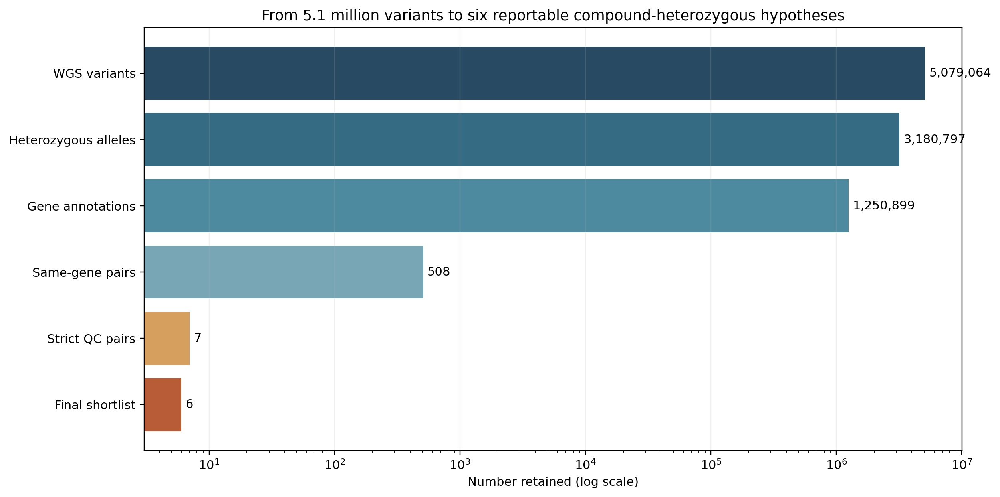
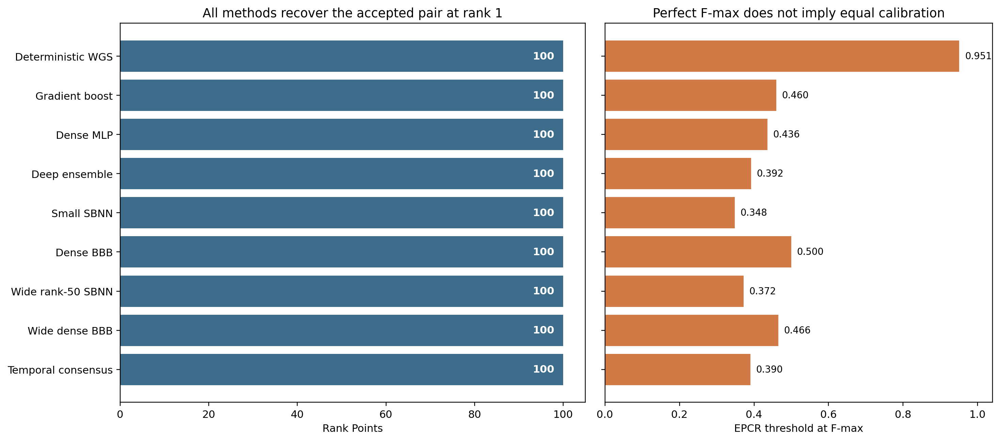
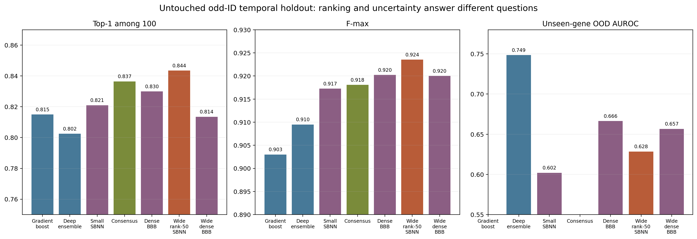
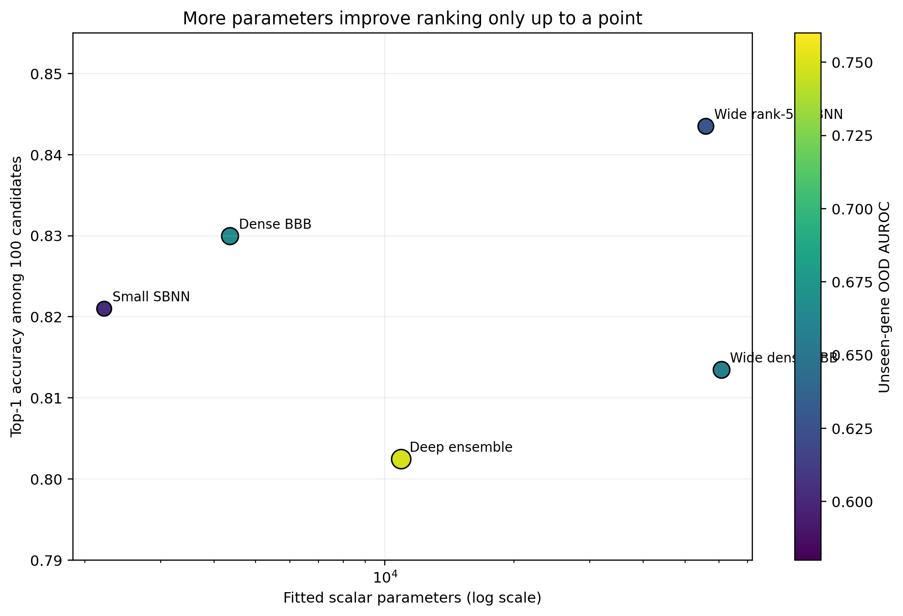
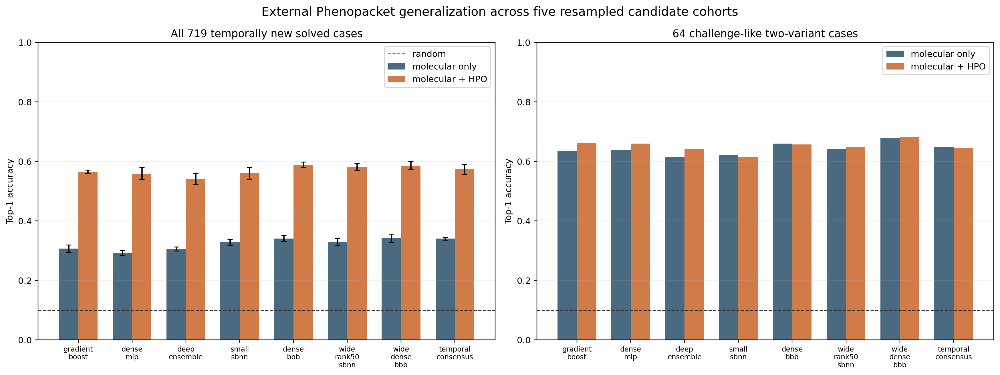
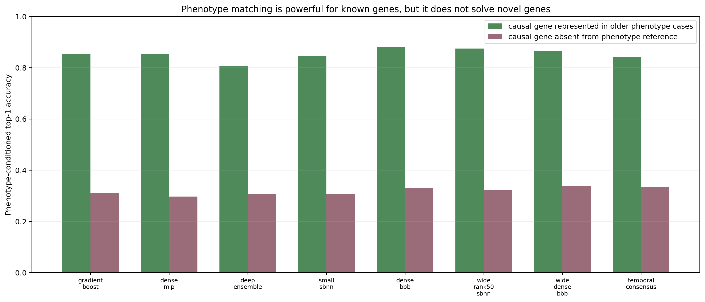

**Genome-wide diagnosis, Bayesian variant ranking, uncertainty, and temporal generalization for the Rare Disease, Real Kid MVA Hackathon 2026**

[Bonaventure F. P. Dossou](https://bonaventuredossou.github.io) and [Mame Diarra Toure](https://arradiat.github.io)

Genome-wide pipeline and Track 1 submission | Bayesian ranking, uncertainty, and generalization

Code: [`bonaventuredossou/hf_rare_disease`](https://github.com/bonaventuredossou/hf_rare_disease) and [`arradiat/Rare-Disease--Real-Kid`](https://github.com/arradiat/Rare-Disease--Real-Kid)

## TL;DR

The genome-wide pipeline identified the accepted compound-heterozygous BUB1B pair at rank 1, and every transferred model reproduced the maximum Track 1 score. What distinguishes this submission is the evidence trail explaining why the pair is credible, every allele-level claim in it verified against gnomAD v4.1.1 and the live ClinVar database, and an explicit account of where the models generalize and where Bayesian uncertainty helps.

## Abstract

Track 1 of the Rare Disease, Real Kid Hackathon asks participants to identify the causal variant or variant pair in one child with mosaic variegated aneuploidy (MVA). We developed a genome-wide workflow and processed the gated whole-genome data, aligned more than one billion reads, normalized and phased 5.08 million variants, joined functional annotations to all but one heterozygous allele, and ranked a compound-heterozygous BUB1B hypothesis first. The uploaded prediction received 100 Rank Points and F-max 1.0. Every population-frequency and clinical-classification claim supporting that pair was then verified by direct query against gnomAD v4.1.1 and ClinVar rather than accepted from the annotation modules.

We then asked a harder question: can a learned method reproduce the child-level result and transfer to variants and patients unavailable at training time? We evaluated a linear Bayesian ranker, deterministic gradient boosting and neural networks, a five-network deep ensemble, low-rank singular Bayesian neural networks (SBNNs), full-weight Bayes-by-Backprop (BBB) networks, wider Bayesian architectures, and a validation-selected consensus. All challenge adapters placed the accepted pair first and achieved the same perfect Track 1 score. Perfect agreement on one proband did not distinguish the models. On an untouched temporal ClinVar holdout, the wide rank-50 SBNN achieved the best simulated top-1 ranking (84.35%) and F-max (0.9235), while the deep ensemble remained the best detector of unseen genes (OOD AUROC 0.7485). On 719 post-2023 solved Phenopacket hypotheses, molecular-only top-1 accuracy was about 34%; an HPO-conditioned dense BBB reached 58.9% +/- 1.0% across five resampled candidate cohorts. The best result on 64 two-variant cases was 68.1% top-1. These patient tests use compact ClinVar-derived candidate sets, not complete external exomes, so they support transfer of the ranking function but not a clinical diagnostic sensitivity claim.

The contribution is a reproducible methodology with explicit separation of candidate generation from ranking, verification of every clinical claim against primary sources, strict temporal and gene-aware evaluation, calibrated claims about uncertainty, and attribution of upstream data and features.

## How to read this report

**Part I (Sections 1 to 15)** is the clinically backed result: the genome-wide pipeline, the evidence for the BUB1B pair, the direct database verification, the open question about the second allele, and the limitations. This is the work behind the submitted prediction file.

**Part II (Sections 16 to 27)** is the Bayesian ranking, uncertainty, and generalization extension. It does not change the submitted prediction. It asks whether a learned model transfers beyond this one child.

## System overview


**Figure 1.** The complete Track 1 system. The pipeline supplies candidate generation and clinical filtering. The comparative modeling work supplies molecular ranking and uncertainty. Patient-level reasoning combines those outputs with HPO similarity, disease validity, phase, and compound-heterozygous logic. The final product is a ranked pair and an inspectable evidence trace.

# Part I. Genome-wide Diagnosis and Clinical Evidence

## Submission 1 Status

**Automated evaluation:** Rank Points = **100/100**, F-max = **1.000**. Both metrics follow the CAGI6 Rare Genomes Project assessment methodology [12], adapted by the organizers to a single proband.

**Repository prediction filename:** `bonaventuredossou_genomewide-hpo-comphet.csv`

The prediction file is named using the participant identifier plus a concise description of the approach: genome-wide WGS prioritization with HPO-guided compound-heterozygous ranking. Its contents are identical to the file originally uploaded to the leaderboard; only the filename differs, so that the repository, the report, and the submitted predictions all refer to the same artifact.

Submission 1 is the primary result described in this report. It was generated by the genome-wide pipeline before any disease-specific MVA reranking was introduced.

The central scientific result is therefore not only that the correct BUB1B pair was submitted, but that it emerged at rank 1 from a broad genome-wide candidate set without a manually assigned BUB1B or MVA-gene bonus.

### Scientific contribution at a glance

- Full WGS analysis using all supplied FASTQ lanes and the supplied VCF.
- Exact GRCh38 reference representation reconstructed and validated against all 2,580 VCF contigs.
- 5,079,064 normalized variants evaluated.
- 3,180,797 heterozygous variants considered.
- 86.60% of heterozygous variants received read-backed phase information.
- 3,180,796 of 3,180,797 heterozygous alleles were matched to functional annotations after canonical allele normalization.
- BUB1B ranked first before disease-specific reranking.
- The leading pair remained first after more conservative predictor scoring, primary-contig restriction, stricter germline QC, and removal of a read-backed cis pair.
- Both BUB1B alleles were independently audited at the raw-read level.
- Both alleles were subsequently verified against gnomAD v4.1.1 and the live ClinVar database, which resolved the second allele from "apparently population-absent" to a confirmed singleton in 1,614,226 alleles and identified a same-residue ClinVar submission the pipeline annotations did not surface.

## Analysis Timeline and Separation of Discovery From Post-Submission Validation

To avoid conflating discovery with later clinical interpretation, the analysis is divided into two phases.

### Pre-submission discovery

Submission 1 was generated from the genome-wide pipeline. The primary ranking did not contain an explicit BUB1B bonus or a whitelist of known MVA genes. HPO-derived phenotype evidence, population rarity, consequence, sequencing QC, ClinVar, CADD, REVEL, SpliceAI, and read-backed phasing were integrated across the genome.

The following refinements were completed before Submission 1:

| Stage | Main change | Effect on leading result |
|---|---|---|
| Canonical annotation join | Reconciled VCF and OpenCRAVAT allele representations | 3,180,796 of 3,180,797 heterozygous alleles matched |
| Conservative predictor revision | Replaced REVEL rankscore with raw REVEL and separated CADD evidence | BUB1B remained rank 1 |
| Primary-contig ranking | Moved unplaced and alternate-contig pairs to an audit tier | BUB1B remained rank 1 |
| Strict germline QC | Required PASS, DP >= 10, GQ >= 20, allele balance 0.20 to 0.80, AF <= 0.005 when observed | BUB1B remained rank 1 |
| Phase-aware exclusion | Removed a ZNF619 pair with read-backed cis evidence | BUB1B remained rank 1 |

### Post-submission analysis

A later MVA-specific clinical reranker was developed only after Submission 1 had already achieved a perfect automated score. It is retained in the repository as a post-submission sensitivity and interpretation analysis, not as evidence that the original discovery was blind to leaderboard feedback.

The post-submission analysis must therefore not be interpreted as an independent validation dataset. Its purpose is to test whether explicit disease knowledge changes the clinical interpretation after the genome-wide discovery has already been established.

## 1. Summary

We analyzed the proband's whole-genome sequencing data and clinical phenotype using a phenotype-guided, genome-wide rare-variant prioritization pipeline.

Our highest-ranked causal hypothesis is a **compound-heterozygous pair in BUB1B**:

| Variant | Consequence | Population evidence | Clinical / computational evidence |
|---|---|---|---|
| **chr15:40209701 T>G** | BUB1B p.Leu737Ter | gnomAD v4.1.1: AF 7.4e-5, no homozygotes, PASS in both callsets | ClinVar Pathogenic/Likely pathogenic, 2 stars (VCV000533901); CADD PHRED 38; LOFTEE high-confidence pLoF |
| **chr15:40220612 T>G** | BUB1B p.Asn1002Lys | gnomAD v4.1.1: 1 allele in 1,614,226, AF 6.2e-7, no homozygotes | CADD PHRED 26.4; REVEL 0.472; PolyPhen 0.997; no ClinVar record for this change, same-residue c.3006T>A is VUS (Section 8) |

The pair was ranked first with:

- **Pair score:** 0.8458
- **EPCR:** 0.950624
- **Finding type:** primary
- **Phase:** unresolved

BUB1B was not manually hard-coded into the ranking. The pipeline recovered it through the combination of phenotype similarity, variant consequence, population rarity, sequencing quality, clinical annotation, and pathogenicity predictions.

## 2. Data

The analysis used the complete challenge dataset for the proband:

- Whole-genome VCF
- Four paired-end FASTQ lanes
- Clinical phenotype document

Genome build:

- **GRCh38**
- Reference representation matched to the supplied VCF:
  `GCA_000001405.15_GRCh38_no_alt_analysis_set_plus_hs38d1_maskedGRC_exclusions_v2_no_chr.fasta`

The reconstructed reference was validated against the VCF sequence dictionary:

- VCF contigs checked: **2,580**
- FASTA contigs: **2,580**
- Missing contigs: **0**
- Length mismatches: **0**

## 3. Clinical Phenotype

Phenotypic features extracted from the supplied challenge document included:

| Phenotype | HPO |
|---|---|
| Rhabdomyosarcoma | HP:0002859 |
| Nephrocalcinosis | HP:0000121 |
| Short stature | HP:0004322 |
| Failure to thrive | HP:0001508 |
| Skeletal muscle atrophy / low muscle mass | HP:0003202 |
| Premature birth | HP:0001622 |
| Small for gestational age / severe intrauterine growth restriction | HP:0001518 |
| Recurrent spontaneous abortion / parental recurrent miscarriages | HP:0200067 |

The complete constellation was used for phenotype-to-gene prioritization rather than relying on any single feature.

## 4. Analysis Workflow

### 4.1 Read alignment and quality control

All supplied paired-end FASTQ reads were analyzed. No genome-wide read downsampling or candidate-gene restriction was used.

Final BAM statistics included:

- Total reads: **1,076,022,862**
- Primary reads: **1,071,835,104**
- Primary mapped reads: **1,067,608,257**
- Mapping rate: **99.61%**
- Read 1: **535,917,552**
- Read 2: **535,917,552**
- Singletons: **0.34%**
- Primary duplicates: **137,812,223**

A one-million-read paired-end audit showed:

- Mate mapped: **99.651%**
- Same chromosome: **98.662%**
- Non-zero template length: **97.964%**
- Median absolute template length: **430 bp**
- IQR: **325 to 558 bp**

The custom alignment path did not preserve the SAM `proper-pair` (`0x2`) classification bit, but mate coordinates, R1/R2 identity, template lengths, and paired-end relationships were retained and independently checked.

### 4.2 Variant normalization

The supplied VCF was normalized against the validated GRCh38 reference before downstream annotation and ranking.

Normalized dataset:

- Total variants: **5,079,064**
- Heterozygous variants: **3,180,797**

### 4.3 Read-backed phasing

WhatsHap [11] was used to add read-backed phase information.

Results:

- Heterozygous variants: **3,180,797**
- Phased heterozygous variants: **2,754,502**
- Fraction phased: **86.60%**
- Phase sets: **439,579**
- Largest phase set: **6,891 heterozygous variants**

Phase evidence was interpreted conservatively:

- Same phase set + opposite haplotypes: evidence for **trans**
- Same phase set + same haplotype: evidence for **cis**
- Different phase sets or unphased variants: **unknown**, not evidence for cis

The two leading BUB1B variants were not connected by a read-backed phase block, so their relative phase remains unresolved.

### 4.4 Functional and population annotation

OpenCRAVAT [8] was used with the following annotation resources:

- ClinVar
- gnomAD v2
- gnomAD v3
- CADD
- REVEL
- SpliceAI

The annotation join used canonical chromosome/position/ref/alt representation to account for VCF versus annotation-tool indel representations.

Join audit:

- Heterozygous alleles: **3,180,797**
- Matched alleles: **3,180,796**
- Unmatched alleles: **1**
- Candidate gene annotations: **1,250,899**

Thus, essentially the complete heterozygous candidate universe was retained for ranking.

## 5. Phenotype-Guided Gene Scoring

HPO-based phenotype similarity scores were generated automatically from the clinical phenotype and ontology resources.

No BUB1B-specific score or manual MVA-gene whitelist was inserted into the primary ranking.

For the final BUB1B candidate:

- Gene prior: **0.0**
- Phenotype score: **0.6641**

This allowed the known MVA biology to emerge through phenotype annotation rather than through a manually forced disease-gene prior.

## 6. Variant Scoring

The conservative final variant score was:

```text
0.36 × consequence
+ 0.26 × rarity
+ 0.20 × sequencing QC
+ 0.10 × ClinVar
+ 0.08 × predictor composite
```

The pathogenicity predictor composite was calculated from available:

- raw REVEL score
- normalized CADD PHRED
- raw SpliceAI delta score

Importantly, the final analysis used **raw REVEL**, not the REVEL rankscore.

This correction reduced the computational contribution of BUB1B p.Asn1002Lys but did not change the leading causal hypothesis.

## 7. Candidate Pair Construction

Candidate compound-heterozygous pairs were constructed from heterozygous variants affecting the same gene.

Initial candidate pairs:

- All pairs: **508**
- Primary-chromosome pairs: **131**
- Non-primary/alternate-contig audit pairs: **377**

Variants on unplaced and non-primary contigs were retained for auditing but prevented from crowding the main competition shortlist.

A strict submission-quality filter required:

- Primary chromosomes 1 to 22, X, or Y
- PASS
- DP ≥ 10
- GQ ≥ 20
- Heterozygous allele balance between 0.20 and 0.80
- Population AF ≤ 0.005 when observed

Seven primary-chromosome pairs survived this strict filter.



**Figure 2.** Reduction from 5,079,064 normalized variants to six reportable candidate pairs. Each stage is a filter applied to the previous stage's output, not a re-query of the raw data.


One pair, in **ZNF619**, had direct read-backed **cis** evidence and was excluded from the final causal shortlist.

The final submission therefore contains six candidate pairs.

## 8. Leading Result: BUB1B

### Variant 1

**chr15:40209701 T>G**

- Gene: **BUB1B**
- Transcript consequence: **p.Leu737Ter**
- Coding change: **c.2210T>G**
- Consequence: stop-gain
- DP: **46**
- GQ: **99**
- Allele balance: **0.543**
- CADD PHRED: **38**
- SpliceAI delta: **0.0300**; Pangolin: **-0.0300**
- phyloP: **2.37**
- LOFTEE: **high-confidence pLoF** on both annotated transcripts
- ClinVar: **Pathogenic/Likely pathogenic**, review status criteria provided, multiple submitters, no conflicts (2 stars), last evaluated 9 October 2024
- ClinVar disease annotation includes **Mosaic variegated aneuploidy syndrome 1**
- Identifiers: dbSNP **rs759242053**, ClinVar Variation ID **533901** (accession VCV000533901.9), ClinGen Allele Registry **CA7475986**, Canonical SPDI **NC_000015.10:40209700:T:G**
- Maximum population AF returned by the installed gnomAD modules: approximately **7.7 × 10⁻⁵**, confirmed against gnomAD v4.1.1 below

Raw pileup evidence:

- REF forward: 13
- REF reverse: 9
- ALT forward: 14
- ALT reverse: 12
- ALT median MAPQ: **60**
- ALT median base quality: **37**

This is a high-confidence pathogenic BUB1B loss-of-function allele.

#### Population frequency verified against gnomAD v4.1.1

The frequency reported by the pipeline was checked directly against gnomAD v4.1.1:

| Callset | Filter | Allele count | Allele number | Allele frequency |
|---|---|---:|---:|---:|
| Exomes | PASS | 115 | 1,461,846 | 7.867e-5 |
| Genomes | PASS | 5 | 152,174 | 3.286e-5 |
| Total | | 120 | 1,614,020 | 7.435e-5 |

The grpmax filtering allele frequency at 95% confidence is 8.341e-5. The highest frequency in any genetic ancestry group is 9.830e-5. No homozygotes are observed in 1,614,020 alleles.

Both callsets carry a PASS filter and the variant page shows no quality warnings, so the frequency is usable as reported. The pipeline value of approximately 7.7e-5 is consistent with the v4.1.1 global figure.

This frequency is appropriate for a recessive carrier allele. At a carrier allele frequency of 7.4e-5, the expected population frequency of a biallelic genotype is on the order of 5e-9, which is consistent with a condition affecting fewer than fifty people worldwide. The complete absence of homozygotes across more than 1.6 million alleles is itself supportive, since biallelic loss of BUB1B function is not expected to be tolerated in a population reference cohort.

#### ClinVar submission detail

The aggregate classification rests on two independent submissions, both of which contribute to it and neither of which conflicts with the other:

| Submitter | Classification | Condition | Accession | Last evaluated |
|---|---|---|---|---|
| Labcorp Genetics (formerly Invitae) | Pathogenic | Mosaic variegated aneuploidy syndrome 1 | SCV000762865.8 | 9 October 2024 |
| GeneDx | Likely pathogenic | not provided | SCV004031025.1 | 17 August 2023 |

These correspond to RCV000641226.9 and RCV003324778.1 respectively. The variant first appeared in ClinVar on 28 May 2018, with the most recent submission on 25 February 2025.

Both submitters cite the same two publications, Hanks et al. 2004 (PMID 15475955) and Rio Frio et al. 2010 (PMID 21190457), which establish the loss-of-function mechanism for BUB1B rather than reporting this specific allele. The classification is therefore mechanism-based, which is the appropriate basis for a nonsense variant in a gene with an established recessive loss-of-function mechanism.

ClinGen annotates BUB1B as a gene associated with an autosomal recessive phenotype, and reports no evidence for haploinsufficiency. Both are consistent with the compound-heterozygous model used here, and with the absence of homozygotes in gnomAD despite a carrier frequency near 7.4e-5.

#### Loss-of-function confidence and annotation agreement

gnomAD applies LOFTEE to this variant and classifies it as a high-confidence predicted loss-of-function allele on both annotated transcripts, including the MANE Select transcript ENST00000287598.11. This is stronger than a bare stop-gain consequence call, because it indicates the premature stop is not rescued by the usual escape mechanisms such as last-exon position.

The VEP annotation on the MANE Select transcript reproduces the pipeline call exactly (c.2210T>G, p.Leu737Ter, stop gained), and the recorded CADD PHRED of 38.0 matches the value reported above. The splice predictors are unremarkable, as expected for a nonsense change (SpliceAI 0.03, Pangolin -0.03).

Regional genomic constraint over the surrounding 1 kb (15-40209000-40210000) is Z = 1.79 with an observed-to-expected ratio of 0.88. This is below the conventional constrained threshold, so regional constraint is mildly supportive at most and is not treated as independent evidence here.

### Variant 2

**chr15:40220612 T>G**

- Gene: **BUB1B**
- Transcript consequence: **p.Asn1002Lys**
- Coding change: **c.3006T>G**
- Consequence: missense
- DP: **28**
- GQ: **99**
- Allele balance: **0.464**
- CADD PHRED: **26.4**
- REVEL: **0.472**
- PolyPhen (max): **0.997**
- SpliceAI delta: **0.0200**; Pangolin: **0.0100**
- phyloP: **3.69**
- No ClinVar record for this nucleotide change, confirmed by direct positional query of the live database. A different nucleotide change producing the same amino acid substitution is classified Uncertain significance (see below)
- No population frequency was returned by the installed gnomAD v2/v3 annotations
- gnomAD v4.1.1, verified directly: **1 allele observed in 1,614,226**, global AF **6.195e-7**, **0 homozygotes**

Raw pileup evidence:

- REF forward: 5
- REF reverse: 11
- ALT forward: 5
- ALT reverse: 8
- ALT median MAPQ: **60**
- ALT median base quality: **37**

The second allele therefore has strong sequencing support.

#### Population frequency verified against gnomAD v4.1.1

The pipeline annotated against gnomAD v2.1 and gnomAD v3, both of which returned no frequency record for this allele. Because gnomAD v4 adds a much larger exome callset, that result was checked directly against gnomAD v4.1.1 rather than reported as population absence.

The allele is present in v4.1.1, as a single exome observation:

| Callset | Filter | Allele count | Allele number | Allele frequency |
|---|---|---:|---:|---:|
| Exomes | PASS | 1 | 1,461,878 | 6.841e-7 |
| Genomes | no variant | 0 | 152,348 | 0 |
| Total | | 1 | 1,614,226 | 6.195e-7 |

No homozygotes are observed. The highest frequency in any genetic ancestry group is 8.474e-7. The single carrier is male (XY). The grpmax filtering allele frequency is not computable at 95% confidence, as expected for a singleton.

Three points follow.

First, the earlier v2/v3 result is now explained rather than merely unconfirmed. The genome callset genuinely does not contain this allele (allele count 0 across 152,348 alleles), and the single observation comes from the v4 exome set, which did not exist in the releases the pipeline used. The absence was real for those releases and was not an annotation join failure.

Second, the site is well covered, so the observation is informative rather than a coverage artifact. An allele number of 1,614,226 means the position was callable across essentially the whole cohort.

Third, this does not weaken the recessive hypothesis. A global frequency of 6.2e-7 with no homozygotes is roughly four orders of magnitude below the 0.005 threshold used in the strict candidate tier, and is fully compatible with a second allele in an ultra-rare recessive condition. Confirming the allele as a real, high-quality singleton is stronger evidence than an unverified absence, because it rules out the possibility that the missing v2/v3 record reflected a representation or coverage problem.

The wording used throughout this report has been corrected accordingly. This allele is described as observed once in gnomAD v4.1.1, not as population-absent.

#### Direct ClinVar query: this allele absent, same-residue VUS present

The live ClinVar database was queried directly for every record at this base, using the positional query `BUB1B[gene] AND 40220612[chrpos38]`, with `15-40209701-T-G(GRCh38)` run first as a positive control. The control returned Variation ID 533901 as expected, confirming the query form.

The positional query returned two records, neither of which is the c.3006T>G change reported here:

| Variant | Protein change | Consequence | Germline classification | Review status |
|---|---|---|---|---|
| NM_001211.6:c.3006T>C | p.Asn1002= | synonymous | Likely benign | single submitter, 1 star |
| NM_001211.6:c.3006T>A | p.Asn1002Lys | missense | Uncertain significance | single submitter, 1 star |

Two conclusions follow, and they point in different directions.

**The specific allele is unclassified.** No ClinVar record exists for chr15:40220612 T>G. This is a direct verified absence rather than an inference from an annotation module returning a blank field, and it is consistent with the installed module (release 2026.07.01) returning no classification and with gnomAD v4.1.1 listing no ClinVar cross-reference for this allele.

**The amino acid substitution is not unclassified.** Asparagine at codon 1002 is encoded by AAT, so both c.3006T>A and c.3006T>G produce p.Asn1002Lys. The identical protein change has therefore been observed by a clinical laboratory, submitted to ClinVar under the generic condition "Inborn genetic diseases", and classified as a variant of uncertain significance.

This must be recorded honestly rather than set aside. Under ACMG criteria, PS1 applies when the same amino acid change has a previously established pathogenic classification. It does not apply here, because the same-residue submission is a VUS. No submitter has classified p.Asn1002Lys as pathogenic.

The weight of that observation is limited. It is a single-submitter, one-star assertion filed against a non-specific condition label, so the submitting laboratory would have had no MVA phenotype against which to evaluate the change, and a VUS explicitly denotes insufficient evidence rather than evidence of benignity. It is not evidence against causality. But it does mean the second allele cannot be presented as a wholly uncharacterised change, and it is the weakest link in the evidence chain supporting this pair.

The synonymous c.3006T>C record is not informative for this allele, since it produces no protein change.

#### Independent confirmation of the annotation

The gnomAD v4.1.1 record independently reproduces the pipeline's transcript and predictor values. VEP on the MANE Select transcript ENST00000287598.11 gives BUB1B c.3006T>G, p.Asn1002Lys, missense, matching the pipeline call exactly, and the recorded CADD PHRED of 26.4 and REVEL of 0.472 match the values reported above.

One counter-signal should be recorded. The genomic constraint of the surrounding 1 kb region (15-40220000-40221000) is Z = -0.8 with an observed-to-expected ratio of 1.06, which places the immediate region in the not-constrained range. Local regional constraint therefore does not add support for this allele, even though the residue itself is conserved (phyloP 3.69) and PolyPhen scores it as probably damaging.

The pathogenicity of p.Asn1002Lys is less established than that of p.Leu737Ter. It should be regarded as a strong candidate missense allele rather than as independently proven pathogenic.

## 9. BUB1B Internal Variant Comparison

All heterozygous BUB1B candidates were examined.

Only two strong coding candidates were identified:

1. **p.Leu737Ter**
2. **p.Asn1002Lys**

The remaining BUB1B heterozygous variants were intronic and had substantially weaker functional evidence. Several also had population frequencies incompatible with an exceptionally rare recessive disease hypothesis.

Thus, p.Asn1002Lys was the strongest plausible second BUB1B allele in the proband.

## 10. Final Ranked Candidate Pairs

| Rank | Gene | Pair score | EPCR | Phase |
|---:|---|---:|---:|---|
| **1** | **BUB1B** | **0.8458** | **0.950624** | Unknown |
| 2 | LRP4 | 0.7069 | 0.827678 | Unknown |
| 3 | DNAH10 | 0.6957 | 0.811000 | Unknown |
| 4 | FCGBP | 0.6495 | 0.730034 | Read-backed trans |
| 5 | PKD1 | 0.6450 | 0.721057 | Read-backed trans |
| 6 | TXNDC11 | 0.6181 | 0.664048 | Unknown |

BUB1B remained the top candidate after:

1. replacing REVEL rankscore with raw REVEL;
2. reducing the effective computational pathogenicity score of p.Asn1002Lys;
3. excluding non-primary contigs from the competition tier;
4. applying stricter sequencing QC;
5. removing a read-backed cis candidate.

This stability increased confidence that the leading result was not produced by one favorable scoring choice.

## 11. Differential Diagnosis and Robustness

The strict genome-wide candidate list contained six retained compound-heterozygous hypotheses. BUB1B was separated from the alternatives by a combination of phenotype evidence, a known pathogenic anchor allele, rarity, functional consequence, and strong raw-read support.

| Gene | Main reason it remained in the strict list | Main reason it ranked below BUB1B |
|---|---|---|
| **BUB1B** | Pathogenic stop-gain plus a rare/absent coding partner with strong read support | Relative phase unresolved |
| LRP4 | Two high-quality coding variants and non-zero phenotype similarity | Second allele was more frequent and had weak REVEL support |
| DNAH10 | Two rare coding variants with good genotype QC | Very low phenotype similarity and weak second-allele predictor evidence |
| FCGBP | Read-backed trans configuration | Both alleles were near the strict population-frequency ceiling |
| PKD1 | Read-backed trans configuration and one stronger missense allele | Second allele was more frequent and had weak REVEL support |
| TXNDC11 | Two variants passed strict germline QC | Both alleles had relatively weak predictor evidence |

The pair in ZNF619 was excluded before final submission because read-backed phasing placed the two variants in **cis**, which is inconsistent with a compound-heterozygous explanation.

### Robustness of the BUB1B result

The leading BUB1B pair was not dependent on one favorable scoring implementation.

| Analysis | BUB1B pair score | Rank |
|---|---:|---:|
| Initial canonical-join ranking | 0.8541 | 1 |
| Conservative raw-REVEL ranking | 0.8458 | 1 |
| Strict primary-contig/QC ranking used for Submission 1 | 0.8458 | 1 |

This stability was treated as stronger evidence than the absolute numerical pair score itself.


## 12. Submitted Primary Hypothesis

```text
PROBAND01
chr15:40209701 T>G
chr15:40220612 T>G
BUB1B
EPCR = 0.950624
finding_type = primary
```

Interpretation:

**BUB1B p.Leu737Ter / p.Asn1002Lys** is the leading candidate compound-heterozygous genotype explaining the proband's phenotype.

The first allele is an established pathogenic BUB1B loss-of-function variant. The second is a high-quality missense variant observed once in 1,614,226 alleles in gnomAD v4.1.1, with no homozygotes and with computational evidence of deleteriousness.

The primary remaining uncertainty is the absence of direct cis/trans phase resolution between the two BUB1B variants from the available short-read data.

## 13. Reproducibility

The analysis was implemented as a reproducible Python pipeline covering:

1. input inspection;
2. clinical phenotype extraction;
3. reference reconstruction and validation;
4. full FASTQ alignment;
5. BAM QC;
6. VCF normalization;
7. read-backed phasing;
8. OpenCRAVAT annotation;
9. HPO phenotype-gene scoring;
10. candidate variant scoring;
11. compound-heterozygous pair construction;
12. strict QC and ranking;
13. Track 1 CSV generation.

### Reproducing Submission 1

The commands below reproduce the Submission 1 workflow on the Mila cluster. The raw challenge files are not included in this repository.

#### 1. Define paths

```bash
REPO=/home/mila/b/bonaventure.dossou/hf_rare_disease
DATA=/network/scratch/b/bonaventure.dossou/rare_disease_data
SCRATCH=/network/scratch/b/bonaventure.dossou
RUN="$DATA/mva_track1_run"

cd "$REPO"
```

The pipeline discovers the supplied VCF, paired-end FASTQs, and clinical phenotype document under `DATA`.

#### 2. Install Python dependencies

The analysis used an existing pip environment rather than Conda or Mamba.

```bash
python -m pip install -r requirements.txt
```

For an exact environment snapshot after installation:

```bash
mkdir -p "$REPO/results"
python --version > "$REPO/results/python_version.txt"
python -m pip freeze | sort > "$REPO/results/pip_freeze.txt"
```

#### 3. Put caches, temporary files, and OpenCRAVAT modules on scratch

The OpenCRAVAT annotation modules used here require roughly 160 GB, so they should not be installed into a small home quota.

```bash
export PIP_CACHE_DIR="$SCRATCH/cache/pip"
export XDG_CACHE_HOME="$SCRATCH/cache"
export TMPDIR="$SCRATCH/tmp"
export SSL_CERT_FILE="$(python -m certifi)"

mkdir -p \
  "$PIP_CACHE_DIR" \
  "$XDG_CACHE_HOME" \
  "$TMPDIR" \
  "$SCRATCH/opencravat/modules"
```

Configure OpenCRAVAT to store modules on scratch:

```bash
oc config md "$SCRATCH/opencravat/modules"
```

Install the base modules and annotation resources:

```bash
oc module install-base

oc module install \
  clinvar \
  gnomad \
  gnomad3 \
  revel \
  spliceai \
  cadd
```

The installed resources used in this analysis were:

| Module | Installed release observed during analysis | Approximate size |
|---|---|---:|
| ClinVar | 2026.07.01 | 1.7 GB |
| gnomAD | v2.1 | 17.4 GB |
| gnomAD3 | v3 | 44.0 GB |
| REVEL | v4.3a resource | 7.0 GB |
| SpliceAI | v4.0 resource | 1.8 GB |
| CADD | v1.6 | 86.6 GB |

For archival reproducibility, record the local OpenCRAVAT module listing after installation:

```bash
oc module ls > "$REPO/results/opencravat_modules.txt"
```

#### 4. Inspect all supplied files

```bash
python mva_track1_pipeline.py inspect \
  --data-dir "$DATA" \
  --verbose
```

This creates the dataset inventory and checks the supplied VCF, FASTQ lanes, phenotype document, and other locally discovered challenge files.

#### 5. Extract phenotype and compute HPO gene scores

```bash
python mva_track1_pipeline.py phenotype \
  --data-dir "$DATA" \
  --verbose
```

The first run downloads the required HPO resources to:

```text
$DATA/resources/hpo/
```

The resulting genome-wide phenotype scores are written under:

```text
$RUN/phenotype/
```

#### 6. Reconstruct and validate the matching GRCh38 reference

```bash
python mva_track1_pipeline.py prepare-reference \
  --data-dir "$DATA" \
  --verbose
```

The stage reconstructs the GRCh38 no-alt plus hs38d1 reference representation named in the supplied VCF header, indexes it, and validates contig names and lengths against the VCF.

The successful validation used in this analysis checked all 2,580 contigs with zero missing contigs and zero length mismatches.

#### 7. Align all FASTQ reads

The final memory-safe alignment configuration used six CPU threads and process-isolated pybwa shards:

```bash
python mva_track1_pipeline.py align \
  --data-dir "$DATA" \
  --threads 6 \
  --align-batch-pairs 2000 \
  --align-shard-pairs 2000000 \
  --bwa-chunk-bases 10000000 \
  --verbose
```

All reads and all four lanes are aligned. `--align-shard-pairs` limits worker lifetime and memory accumulation; it does not downsample the data.

Use `--force` only when intentionally rebuilding an existing alignment:

```bash
python mva_track1_pipeline.py align \
  --data-dir "$DATA" \
  --threads 6 \
  --align-batch-pairs 2000 \
  --align-shard-pairs 2000000 \
  --bwa-chunk-bases 10000000 \
  --force \
  --verbose
```

The main BAM QC report is:

```text
$RUN/alignment/flagstat.txt
```

#### 8. Normalize the supplied VCF

```bash
python mva_track1_pipeline.py normalize \
  --data-dir "$DATA" \
  --threads 6 \
  --verbose
```

This left-normalizes variants and splits multiallelic records against the validated reference.

#### 9. Perform read-backed phasing

```bash
python mva_track1_pipeline.py phase \
  --data-dir "$DATA" \
  --threads 6 \
  --verbose
```

The analysis phased 2,754,502 of 3,180,797 heterozygous variants, corresponding to 86.60%.

#### 10. Run functional and population annotation

```bash
python mva_track1_pipeline.py annotate \
  --data-dir "$DATA" \
  --threads 6 \
  --oc-annotators clinvar gnomad gnomad3 revel spliceai cadd \
  --verbose
```

All annotation is performed locally against the installed OpenCRAVAT modules.

#### 11. Rank variants and construct compound-heterozygous pairs

```bash
python mva_track1_pipeline.py rank \
  --data-dir "$DATA" \
  --threads 6 \
  --verbose
```

Important outputs include:

```text
$RUN/ranking/variant_candidates.tsv
$RUN/ranking/compound_het_pairs.tsv
$RUN/ranking/compound_het_pairs_nonprimary_audit.tsv
$RUN/ranking/scoring_audit_v12.json
$RUN/ranking/annotation_join_audit.json
```

The strict Submission 1 ranking contains the six retained primary candidates headed by the BUB1B pair.

#### 12. Generate the exact Submission 1 schema

`PROBAND01` must be supplied explicitly because the internal sequencing sample name is `WGS_EX2312012`.

```bash
python mva_track1_pipeline.py submit \
  --data-dir "$DATA" \
  --proband-id PROBAND01 \
  --top-n 6 \
  --submission-name bonaventuredossou_genomewide-hpo-comphet.csv \
  --verbose
```

The generated prediction file is:

```text
$RUN/ranking/bonaventuredossou_genomewide-hpo-comphet.csv
```

To copy it into the public repository:

```bash
cp \
  "$RUN/ranking/bonaventuredossou_genomewide-hpo-comphet.csv" \
  "$REPO/bonaventuredossou_genomewide-hpo-comphet.csv"
```

#### 13. Optional single-command execution

After dependencies and OpenCRAVAT resources are installed, the complete workflow can also be launched with:

```bash
python mva_track1_pipeline.py all \
  --data-dir "$DATA" \
  --threads 6 \
  --align-batch-pairs 2000 \
  --align-shard-pairs 2000000 \
  --bwa-chunk-bases 10000000 \
  --oc-annotators clinvar gnomad gnomad3 revel spliceai cadd \
  --proband-id PROBAND01 \
  --top-n 6 \
  --submission-name bonaventuredossou_genomewide-hpo-comphet.csv \
  --verbose
```

For debugging or cluster workflows, the stage-by-stage execution above is preferred because it preserves expensive completed stages and makes intermediate validation explicit.

#### 14. Copy non-sensitive audit summaries to the repository

```bash
mkdir -p "$REPO/results"

cp "$RUN/ranking/scoring_audit_v12.json" \
   "$REPO/results/scoring_audit.json"

cp "$RUN/ranking/annotation_join_audit.json" \
   "$REPO/results/annotation_join_audit.json"

cp "$RUN/alignment/flagstat.txt" \
   "$REPO/results/alignment_flagstat.txt"
```

Do not copy the raw FASTQs, full VCF, BAM/BAI, phased VCF, clinical document, OpenCRAVAT database, or full patient-level candidate tables into the public repository.

No patient-specific training data were available or assumed. External resources were used as annotation and prior biological evidence rather than as labels for supervised training on this patient.

### Repository contents

The public repository contains:

- `mva_track1_pipeline.py`, the pipeline used to produce Submission 1
- `requirements.txt`, the dependency specification, together with `results/pip_freeze.txt` and `results/python_version.txt` recording the exact environment used
- the stage-by-stage commands given above, and the equivalent single driver command
- the configuration needed to reconstruct and validate the GRCh38 reference representation
- the phenotype extraction and HPO gene-scoring code
- the OpenCRAVAT ingestion code and the canonical allele joining logic
- the phasing, ranking, QC, pair construction, and submission generation code
- `results/scoring_audit.json`, `results/annotation_join_audit.json`, and `results/alignment_flagstat.txt`, the aggregate audit summaries needed to reproduce the statistics reported here
- `bonaventuredossou_genomewide-hpo-comphet.csv`, the submitted prediction file, and this report

The gated challenge data are **not** committed to the public repository. The repository contains no raw FASTQ, VCF, BAM/BAI, or phased VCF file, no copy of the clinical document, no full patient-level candidate variant table, and no credentials or access tokens.

### AI assistance disclosure

**OpenAI ChatGPT**, accessed through a ChatGPT Plus account, was used to help implement and debug the analysis code, reason through intermediate results, inspect failure modes, refine the ranking pipeline, and draft portions of this report.

The participant defined the research direction, the hypotheses, and the choice of which analyses to run. The model assisted with translating those decisions into executable code and with interpreting the resulting outputs. No candidate call or conclusion was accepted because a model suggested it. Every result reported here was checked against the supplied WGS data, the annotation resources, read-level evidence, phenotype evidence, and reproducible pipeline outputs.

All computation was executed by the participant on the Mila cluster.

The following categories of material were shared with the model:

- pipeline source code, configuration, and error traces
- aggregate quality-control summaries, specifically the alignment flagstat totals, variant and heterozygous counts, phasing counts, and annotation join counts reported in this document
- the ranking and scoring audit summaries
- coordinates, consequences, and public annotation values (ClinVar, gnomAD, CADD, REVEL, SpliceAI) for the small number of top-ranked candidate pairs, including the two BUB1B alleles
- the HPO terms listed in Section 3

The following were never uploaded to, or accessible by, any third-party service:

- the raw FASTQ files
- the supplied VCF, the normalized VCF, and the read-phased VCF
- the BAM and BAI alignment files
- the clinical phenotype document as supplied
- the full patient-level candidate variant tables

The material shared for interpretation is therefore a subset of what appears in this report and in the submitted prediction file, both of which are released under CC BY 4.0 as part of the Hackathon. No gated file was redistributed, and no patient-level dataset was placed in a third-party environment.


### Reproducibility boundary

The supplied challenge data are gated. The repository therefore provides code and instructions that reproduce the analysis once an authorized participant places the challenge files in the expected local directory. It does not redistribute the files themselves.


**Repository:** [https://github.com/bonaventuredossou/hf_rare_disease](https://github.com/bonaventuredossou/hf_rare_disease)

## 14. Open Question: the Status of BUB1B p.Asn1002Lys

The causal hypothesis is limited by one allele, and the direct database checks described in Section 8 sharpen rather than resolve that limitation. Collecting the position in one place:

- chr15:40220612 T>G is present in gnomAD v4.1.1 as a single PASS observation in 1,614,226 alleles (AF 6.195e-7), with no homozygotes, at a position callable across essentially the whole cohort.
- No ClinVar record exists for this nucleotide change, confirmed by direct positional query against the live database.
- The identical amino acid substitution, reached through c.3006T>A, is present in ClinVar as a single-submitter variant of uncertain significance filed under the generic condition label "Inborn genetic diseases".
- Computational evidence is mixed. CADD 26.4, PolyPhen 0.997, and phyloP 3.69 favour deleteriousness; REVEL 0.472 is equivocal; regional constraint (o/e 1.06) is unremarkable; splice predictors are null.

The substantive point is that this is a variant on which the public resources have not reached a conclusion, and that the one laboratory to have assessed the amino acid change did so without a phenotype that would have made BUB1B relevant. This proband supplies exactly that missing context: a phenotype concordant with mosaic variegated aneuploidy, and a second allele that is an established pathogenic BUB1B stop-gain.

Three things would resolve the question, in increasing order of effort:

1. **Segregation.** Parental sequencing would establish whether the two alleles are in trans. This is the single highest-value missing datum and requires no new method.
2. **Direct phasing.** The two variants are 10,911 bp apart, beyond the reach of the short-read fragments used here. Long-read sequencing or targeted long-range PCR across the interval would settle phase without parental samples.
3. **Functional assessment.** An assay of BubR1 kinetochore function or a chromosome missegregation readout in patient-derived cells would provide the evidence class that computational prediction cannot supply, and is the evidence a ClinVar submitter would need to move this allele off uncertain significance.

If the phase and segregation questions were answered, the case for a formal ACMG classification of p.Asn1002Lys would be materially stronger than it is today, and the observation would be worth returning to ClinVar so that the next laboratory to encounter this residue has the phenotype context that the existing submission lacks. Any such submission would involve patient-derived data and would require the agreement of the family and the Hackathon organizers under the data-sharing terms of this challenge; it is raised here as a scientific recommendation, not as an action taken.

## 15. Limitations

Several limitations remain:

- Parental genomes were not provided, preventing direct segregation analysis.
- Short-read phasing could not establish whether the two BUB1B variants are in trans.
- Computational prediction cannot independently establish pathogenicity of the p.Asn1002Lys missense allele.
- Structural variants, complex repeat-associated events, and other variant classes may require specialized analyses beyond the supplied small-variant VCF.
- The pipeline annotated against gnomAD v2.1 and v3. The frequencies reported for both BUB1B alleles were subsequently verified by direct lookup against gnomAD v4.1.1, but the ranking itself was computed from the older releases, so the rarity term for p.Asn1002Lys treated the allele as unobserved rather than as a singleton. This does not change the ranking, since both values fall far below the filtering threshold used.
- The specific nucleotide change c.3006T>G has no ClinVar record, confirmed by direct query. However, c.3006T>A, which produces the identical p.Asn1002Lys substitution, is classified in ClinVar as a variant of uncertain significance. ACMG criterion PS1 therefore does not apply to this allele, and no submitter has classified this amino acid change as pathogenic.
- Regional genomic constraint around p.Asn1002Lys is unremarkable (o/e 1.06), so constraint does not independently support this allele.
- Regional genomic constraint around p.Leu737Ter (o/e 0.88, Z = 1.79) falls below the conventional constrained threshold, so constraint is at most mildly supportive for this allele as well.
- The ClinVar classification for p.Leu737Ter is a two-star aggregate rather than an expert-panel or practice-guideline assertion.
- Extreme rarity in population databases is supportive but is not by itself proof of pathogenicity.
- The ranking model is an evidence-prioritization system and is not intended to substitute for clinical molecular interpretation.

# Part II. Bayesian Ranking, Uncertainty, and Generalization

Part I established the clinical result: a genome-wide, phenotype-guided pipeline recovered the accepted compound-heterozygous BUB1B pair at rank 1, and every allele-level claim in it has been verified against gnomAD v4.1.1 and the live ClinVar database.

Part II asks a different question. The deterministic workflow already solved this child. A learned model is justified only if it adds knowledge beyond that one case. Everything below therefore concerns transfer, calibration, and uncertainty, not the submitted prediction, which is unchanged.

## 16. Team Contributions and Model Boundaries

This is joint work by Bonaventure Dossou and Mame Diarra Toure. The diagnosis, modeling results, challenge submission, scientific interpretation, and final outcome belong to the team. The division below records how the system was built. It is not a division of ownership.

Bonaventure developed the original genome-wide workflow, ran it on the cluster, produced the feature and candidate tables, and prepared the submitted CSV [14]. This includes input discovery, reference preparation, alignment, normalization, phasing, local annotation, HPO gene scoring, variant scoring, pair construction, QC, and submission export. That work is Part I of this report.

Mame developed the Bayesian ranking and generalization extension [15]: formulation of the learned ranking problem; construction of the shared feature contract; implementation and evaluation of the linear Bayesian, SBNN, dense BBB, ensemble, gradient-boosting, and consensus models; SBNN hyperparameter studies; temporal ClinVar and Phenopacket/HPO experiments; Track 1 score verification; uncertainty and calibration analysis; and visualization and reproducibility work.

The two parts are interdependent. The Bayesian models could not have been trained and transferred to the child without the valid candidate universe and biological features produced by the genome-wide pipeline. The pipeline, in turn, is extended by the comparative models, external generalization tests, and uncertainty analysis.

The first pair models consume these exported features:

- phenotype score;
- minimum and maximum consequence severity across the two alleles;
- minimum and mean rarity, maximum allele frequency, and missingness fraction;
- minimum and maximum normalized CADD and SpliceAI scores, plus availability indicators;
- phenotype-by-consequence and phenotype-by-rarity interaction terms;
- the same pair identity, phase exclusion, and strict/broad candidate definitions.

The temporal ClinVar models are a separate molecular layer. Their 50 features come directly from ClinVar records and training-only gene summaries. When transferred back to Track 1, they score the alleles in the Part I candidate tables, combine the two allele probabilities geometrically, and multiply by the Part I phenotype score. They do not replace the annotation, filtering, phase logic, or pair construction described in Part I.

**Attribution rule.** The challenge result is a property of the team's full system. It would be incorrect to attribute it to either component in isolation. Every learned model receives a candidate universe and biological features from the genome-wide pipeline, while the extended evidence about transfer, calibration, and uncertainty comes from the comparative modeling work.

## 17. Objectives of the Bayesian Layer

Three objectives were separated:

1. **Track 1 compatibility.** Preserve the accepted pair at rank 1.
2. **Molecular generalization.** Recognize pathogenic variants that entered ClinVar after training.
3. **Patient generalization and uncertainty.** Rank causal hypotheses for other solved diseases and identify unsupported cases.

This changes the learning target. The model does not consume FASTQ reads. It receives annotated candidate alleles or pairs and predicts a pathogenicity or causality score. Deterministic processing remains responsible for valid observations and inheritance-consistent hypotheses.

## 18. Training Data Provenance for the Learned Models

| Dataset | Source and access | Local acquisition | Use and boundary |
|---|---|---|---|
| Compact ranking export | Derived from the Part I cluster run [14], imported by the integrated Bayesian repository [15] | `ranking.zip` copied to the project workspace; contains candidate tables, not FASTQ/BAM/VCF data | Let the Bayesian rankers consume exactly the same strict and broad candidate pairs without moving the 85 GB dataset |
| Phenopacket Store 0.1.27 | Monarch Initiative corpus and versioned release [16, 17] | Release archive downloaded by HTTPS, 19 MB | Solved patients, causal GRCh38 variants, genes, source groups, HPO terms. Used for the 425/44/89 pair benchmark and the 719-case temporal patient benchmark |
| Phenopacket molecular annotation cache | Benchmark adapter built from Phenopacket variants and VEP-derived annotations | Only fitted model artifacts and reports retained | Consequence, population-frequency, CADD, and SpliceAI values for causal and benign decoy alleles. Candidate sets were constructed and are not full patient genomes |
| ClinVar 26 December 2023 | Official NCBI archived GRCh38 VCF [2] | `clinvar_20231226.vcf.gz`, 87 MB | Training-time labels and gene-history features. 1,084,930 unambiguous labeled variants, 2,340,600 total Variation IDs |
| ClinVar 29 August 2026 | Official NCBI GRCh38 VCF [2] | `clinvar_20260829.vcf.gz`, 184 MB | Temporal evaluation. Records with Variation IDs absent in 2023 form a 626,287-variant test set |
| HPO 2023-10-09 | Official HPO release [3] | `v2023-10-09/hp.obo`, 9.2 MB | The 2023 ontology was used in the temporal patient benchmark to avoid a post-cutoff knowledge dependency |
| Track 1 ground-truth behavior | Public challenge evaluator and accepted leaderboard result [18] | Evaluator logic reproduced locally; private ground-truth file was not copied | Used only to verify that generated CSVs reproduce Rank Points 100 and F-max 1.0 |

### Checksums of compact public inputs

The public files used in the final temporal analysis are small enough to reproduce without the gated WGS:

- 2023 ClinVar: `510c54e3fd04b078...cb63786`
- 2026 ClinVar: `e72f5619f003c80c...6ec91f9`
- Phenopacket Store 0.1.27: `d0c70005bb09b870...edf205a`
- HPO 2023-10-09: `d3c1280f2780628c...e6cd4e52`

Full hashes are recorded in the repository README. No access token is stored in code or documentation.

## 19. Model Family 1: Bayesian Conditional-Logit Pair Ranker

### Training data and target

The first learned benchmark loaded 9,739 solved Phenopacket cases, including 959 reported two-variant cases. After annotation and decoy requirements, 425 cases were used for training, 44 for validation, and 89 for development testing. Genes, source publications, and case identifiers were disjoint across splits. BUB1B was excluded.

Each case had 23 constructed candidate pairs. The target $y_i$ was the index of the reported causal pair. For feature vector $x_{ij}$ of candidate $j$ in case $i$, conditional logit assigns

$$p(y_i = j \mid X_i, w) = \frac{\exp(w^\top x_{ij})}{\sum_k \exp(w^\top x_{ik})}$$

A zero-centered Gaussian prior regularizes $w$. The maximum-a-posteriori estimate was optimized, and a Laplace approximation around it provided a Gaussian posterior. Prior scale was selected by validation negative log likelihood.

### Result

On 89 held-out development cases, the fixed evidence rule achieved 70.8% top-1 and 83.1% top-5. The Bayesian posterior mean achieved 58.4% top-1 and 87.6% top-5.

The learned model improved shortlist retention but was worse at rank 1. This negative result showed that 425 simplified cases were insufficient for an end-to-end pair learner to replace explicit biological structure.

## 20. Model Family 2: First Low-Rank SBNN Pair Model

The first SBNN [19] used the same 15 pair features and the same 425/44/89 split. Hidden widths were 32 and 16, with factor ranks (8, 8, 1). For a Bayesian layer, a sampled weight matrix is represented by low-rank factors:

$$W = AB^\top, \qquad q(A)\,q(B)\,q(b) = \prod_r \mathcal{N}(\mu_r, \sigma_r^2)$$

Training minimizes a Monte Carlo estimate of

$$\mathcal{L} = \mathbb{E}_{q(W)}\big[-\log p(y \mid X, W)\big] + \lambda\,\mathrm{KL}\big[q(W)\,\Vert\,p(W)\big]$$

Both random and SVD-based mean initialization were tested. Posterior predictive probabilities average softmax predictions over sampled weights. Mutual information between the sampled predictions and their mean estimates epistemic uncertainty.

The SBNN achieved 56.2% top-1 and 87.6% top-5 on the same development set. The result did not justify replacing the rule. It motivated a larger and cleaner variant-level task.

## 21. Temporal ClinVar Experiment

### Why a temporal split

Random ClinVar splits leak stable gene and annotation patterns. A temporal split asks a more useful question: can a model trained on the 26 December 2023 knowledge state classify records whose Variation IDs were absent then and appeared by 29 August 2026? Archived ClinVar releases make this test reproducible [2].

The historical release supplied 1,084,930 unambiguous benign/pathogenic labels. A balanced 60,000-variant training set contained 30,000 pathogenic variants across 5,043 genes. A 15,000-variant gene-disjoint validation set contained 1,209 genes. The temporal test contained 626,287 new records, including 117,147 pathogenic variants across 14,715 genes.

### Fifty molecular features

No clinical-significance label or disease name was used as an input. Features included reference and alternate length, variant type, transition status, substitution class, population frequency and missingness, dbSNP availability, germline/inherited/de-novo origin flags, review-level indicators, molecular consequence categories, and three gene-history quantities computed only from the training split: training count, pathogenic rate, and an unseen-gene flag.

### Core baselines

Four aligned models used the same data and features:

- histogram gradient boosting, a strong nonlinear tabular baseline;
- a dense 50-32-16-1 MLP;
- a five-member independently trained MLP ensemble [20];
- a low-rank SBNN with ranks (8, 8, 1) [19].

The temporal set was then split by ClinVar Variation-ID parity. Even IDs selected a consensus weight; 313,171 odd IDs remained untouched. The selected consensus was 0.30 gradient boost, 0.20 deep ensemble, and 0.50 SBNN.

### Results on the untouched odd-ID holdout

Ranking cases contain one pathogenic variant and 99 temporal benign variants.

| Model | PR-AUC | F-max | NLL | Top-1 | Top-5 | OOD AUROC |
|---|---:|---:|---:|---:|---:|---:|
| Gradient boost | 0.9674 | 0.9030 | 0.1924 | 81.50% | 94.05% | n/a |
| Deep ensemble | 0.9688 | 0.9095 | **0.1245** | 80.25% | 95.00% | **0.7485** |
| Small SBNN | 0.9691 | 0.9173 | 0.1332 | 82.10% | 94.30% | 0.6020 * |
| Consensus | 0.9731 | 0.9181 | 0.1358 | 83.65% | 94.80% | n/a |
| Dense BBB | 0.9729 | 0.9202 | 0.1245 | 83.00% | 94.55% | 0.6665 |
| Wide rank-50 SBNN | **0.9736** | **0.9235** | 0.1232 | **84.35%** | 94.85% | 0.6284 |
| Wide dense BBB | 0.9718 | 0.9200 | 0.1276 | 81.35% | **95.05%** | 0.6567 |

\* The original small-SBNN OOD result was computed on the full temporal set. It is context rather than a perfectly matched holdout value.

## 22. Bayesian Architecture Experiments

### Factorial SBNN sweep

The interaction between rank, KL weight, posterior scale initialization, and broad prior scale was tested jointly rather than one variable at a time. The full grid contained 375 configurations:

- ranks (8,4,1), (8,8,1), (16,8,1), (16,16,1), and (32,16,1);
- KL weights 0.001, 0.01, 0.1, 1, and 3;
- posterior scale multipliers 0.1, 0.3, 1, 3, and 10;
- broad prior standard deviations 0.3, 1, and 3.

The best confirmed compact configuration used ranks (8,4,1), KL 0.01, posterior multiplier 0.1, and prior scale 0.3. Its unseen-gene OOD AUROC was 0.6231, up from 0.6020, but below the deep ensemble's 0.7485.

Some screen configurations exceeded 0.70 OOD AUROC only by degrading classification toward chance. These were rejected rather than promoted as uncertainty improvements.

### Full-weight Bayes by Backprop

The low-rank posterior couples uncertainty through A and B. A dense BBB model instead assigns every weight and bias an independent Gaussian mean and rho [21]. A 75-cell grid crossed rho initialization {-8, -6, -5, -4, -3}, KL weight {0.001, 0.01, 0.1, 1, 3}, and prior scale {0.3, 1, 3}. The winner used rho -4, KL 0.1, and prior scale 0.3.

Dense BBB used 4,354 variational scalars, versus 10,885 fitted weights across the five-network ensemble. On the untouched holdout it achieved 83.0% top-1, F-max 0.9202, and OOD AUROC 0.6665. It improved ranking over the ensemble but did not match ensemble OOD detection.

### Wider low-rank and dense models

To test whether the original network was simply too small, widths increased from 32-16 to 200-100. Ranks 8, 16, 32, 50, and the algebraically full factorization were crossed with KL and posterior-scale settings. The selected rank-50 SBNN used 55,804 variational scalars, only 8% fewer than the matching wide dense BBB. It achieved the best temporal top-1 (84.35%), PR-AUC (0.9736), F-max (0.9235), and 80%-coverage balanced accuracy (99.12%). Its OOD AUROC remained 0.6284.

Increasing rank and width improved the main classification task but did not create ensemble-like function-space diversity.

## 23. Track 1 Comparison: Every Compatible Model Finds the Pair

The official evaluator logic was reproduced locally against the leaderboard-confirmed accepted pair. The deterministic CSV described in Part I is the artifact actually uploaded and independently confirmed by the leaderboard. The learned CSVs were scored locally using the same logic.

| Method | Rows | Pair rank | Rank Points | F-max | Status |
|---|---:|---:|---:|---:|---|
| Deterministic WGS pipeline (Part I) | 6 | 1 | 100 | 1.000 | Uploaded and leaderboard-confirmed |
| Linear Bayesian, strict | 6 | 1 | 100 | 1.000 | Local official-equivalent score |
| Linear Bayesian, broad | 10 | 1 | 100 | 1.000 | Local official-equivalent score |
| Pair SBNN, strict | 6 | 1 | 100 | 1.000 | Local official-equivalent score |
| Pair SBNN, broad | 10 | 1 | 100 | 1.000 | Local official-equivalent score |
| Gradient boost adapter | 6 | 1 | 100 | 1.000 | Local official-equivalent score |
| Dense MLP adapter | 6 | 1 | 100 | 1.000 | Local official-equivalent score |
| Deep ensemble adapter | 6 | 1 | 100 | 1.000 | Local official-equivalent score |
| Small SBNN adapter | 6 | 1 | 100 | 1.000 | Local official-equivalent score |
| Dense BBB adapter | 6 | 1 | 100 | 1.000 | Local official-equivalent score |
| Wide rank-50 SBNN adapter | 6 | 1 | 100 | 1.000 | Local official-equivalent score |
| Wide dense BBB adapter | 6 | 1 | 100 | 1.000 | Local official-equivalent score |
| Temporal consensus adapter | 6 | 1 | 100 | 1.000 | Local official-equivalent score |



**Figure 3.** Every transferred model places the accepted pair first, but the EPCR threshold that isolates it varies widely. A perfect F-max on one child is not a calibration comparison.

The pair remains first because the upstream candidate construction described in Part I is already strong. Only biologically plausible same-gene pairs survive, direct cis evidence is removed, the BUB1B pair combines a pathogenic stop-gain with an ultra-rare coding partner, and its phenotype score is high. The learned models order this compact set consistently. This is reassuring for robustness but cannot identify the best generalizing model.

### Interpretation of the temporal table

Every entry uses the same 50 molecular features and the same untouched odd-ID test cases. For the ranking columns, 2,000 pathogenic temporal variants were each placed among 99 benign temporal variants sampled with a fixed seed. Top-1 and top-5 report where the known pathogenic item appears in that 100-candidate list. PR-AUC and F-max are calculated over all 313,171 odd-ID records. NLL evaluates probability quality and penalizes confident errors. OOD AUROC asks whether a model-specific uncertainty score can distinguish variants in genes absent from the 2023 training set. It is not another pathogenicity score. The consensus weights were chosen on even Variation IDs before the odd-ID table was evaluated.

**Gradient boosting** is the strong non-Bayesian tabular baseline. Its 81.5% top-1 and 0.9674 PR-AUC show that much of the signal is already present in the engineered molecular features. It has no posterior or independently trained members, so no stochastic OOD score is assigned.

**The five-network ensemble** averages five dense networks trained independently from different initial conditions. Its 80.25% top-1 is not the best ranking result, but its NLL of 0.1245 and unseen-gene AUROC of 0.7485 are the strongest tested calibration and OOD combination. The disagreement is useful because independently optimized networks reach different function-space solutions.

**The original small SBNN** replaces deterministic dense layers with low-rank Gaussian factors and averages Monte Carlo weight samples. It improves top-1 to 82.1%, but its 0.602 OOD AUROC is weak. This negative result is why rank, width, posterior initialization, prior scale, and KL weight were studied jointly rather than assuming that a Bayesian label guarantees useful uncertainty.

**The temporal consensus** combines gradient boosting, the ensemble, and the small SBNN using weights selected on the even-ID partition. It raises top-1 to 83.65% and PR-AUC to 0.9731. Their errors are complementary, although the score is a predictive mixture rather than a single coherent posterior.

**Dense BBB** assigns an independent Gaussian mean and scale to every network parameter. Its 83.0% top-1, 0.9729 PR-AUC, and 0.6665 OOD AUROC improve on the small SBNN's ranking and OOD behavior. It still does not match the ensemble's unseen-gene detection.

**The wide rank-50 SBNN** uses 200- and 100-unit hidden layers and much less restrictive factors. It gives the best tested ranking: 84.35% top-1, PR-AUC 0.9736, F-max 0.9235. Its OOD AUROC remains 0.6284, so the result supports the larger SBNN as a pathogenicity ranker, not as the final uncertainty gate.

**The wide dense BBB** is the matching full-weight Bayesian comparison. It reaches 81.35% top-1 and 0.6567 OOD AUROC, with the best top-5 value at 95.05%. Widening alone therefore does not explain the rank-50 SBNN's top-1 gain, and a dense posterior does not automatically reproduce the ensemble's diversity.



**Figure 4.** Task ranking, F-max, and unseen-gene detection favor different models. Empty OOD bars indicate that no model-specific stochastic uncertainty was defined for that method.



**Figure 5.** Parameter count alone does not explain performance. The wide rank-50 SBNN gives the best ranking, while the smaller deep ensemble gives the strongest OOD signal because its members occupy independently optimized function-space modes.


## 24. External Patient-Level Generalization

### Construction without test leakage

Phenopacket Store cases with one or two exact GRCh38 causal variants were used. A causal hypothesis entered the test only when every causal coordinate was absent from the raw 2023 ClinVar snapshot and pathogenic in the 2026 snapshot. Repeated causal hypotheses were deduplicated. This retained 719 post-2023 cases from 265 genes: 655 single-variant and 64 two-variant cases.

Each case had one causal hypothesis and nine temporally new benign ClinVar hypotheses. Single-variant decoys were matched on variant type and consequence group when possible. Two-variant decoys contained two benign alleles in one gene. The molecular score of a pair was the geometric mean of its allele probabilities. Ten candidates imply a 10% random top-1 baseline.

The HPO layer used only the 9 October 2023 ontology. Older solved cases were split into 1,388 phenotype-reference cases and 843 weight-selection cases. The validation split included familiar genes and genes entirely removed from the reference. For candidate gene $g$ and patient phenotype set $Q$, the score was the best symmetric Resnik similarity between `Q` and an older case for `g`. Each model selected a molecular/HPO coefficient and missing-gene prior on the 843 older cases. The 719 post-2023 patients remained untouched.

Five independent benign candidate cohorts tested sensitivity to decoy composition. Reported means and sample standard deviations reflect candidate resampling, not five independent patient cohorts.

### Results

Mean top-1 generalization across five candidate cohorts.

| Model | Molecular | Molecular + HPO | Change | HPO top-5 | Two-variant top-1 |
|---|---:|---:|---:|---:|---:|
| Gradient boost | 30.6 ± 1.3 | 56.5 ± 0.6 | +25.9 | 86.5 | 66.2 |
| Dense MLP | 29.2 ± 0.8 | 55.9 ± 2.0 | +26.6 | 84.3 | 65.9 |
| Deep ensemble | 30.6 ± 0.7 | 54.2 ± 1.9 | +23.6 | 85.0 | 64.1 |
| Small SBNN | 32.9 ± 1.0 | 55.9 ± 1.9 | +23.1 | 85.3 | 61.6 |
| Dense BBB | 34.1 ± 1.0 | **58.9 ± 1.0** | +24.8 | 88.5 | 65.6 |
| Wide rank-50 SBNN | 32.8 ± 1.2 | 58.2 ± 1.1 | +25.4 | 86.6 | 64.7 |
| Wide dense BBB | **34.2 ± 1.4** | 58.6 ± 1.4 | +24.4 | 85.9 | **68.1** |
| Temporal consensus | 34.0 ± 0.5 | 57.3 ± 1.7 | +23.3 | **88.6** | 64.4 |



**Figure 6.** External patient-level ranking. Error bars in the left panel are standard deviations over five decoy cohorts. The two-variant subset is closest to the challenge's compound-heterozygous structure.

For dense BBB, HPO conditioning improved top-1 accuracy by 23.5 to 26.1 percentage points in every cohort. Each paired comparison gained 175 to 194 cases while losing only 2 to 6, with exact McNemar p-values between approximately 1e-44 and 1e-53. The effect is statistically clear within this benchmark.

### Known-gene and unseen-gene behavior

Of the 719 test cases, 337 had a causal gene represented in older phenotype cases and 382 did not. Dense BBB rose from 34.7% to 88.1% top-1 on the known-gene subset, but stayed near baseline on unseen genes (33.6% to 33.1%).

The tuned missing-gene prior prevents a catastrophic penalty when phenotype knowledge is absent, but it does not invent knowledge about novel genes. Phenotype matching works when the candidate gene has older phenotype evidence. Novel-gene diagnosis remains a molecular and discovery problem.



**Figure 7.** Phenotype matching works when the candidate gene has older phenotype evidence. Novel-gene diagnosis remains a molecular and discovery problem.


## 25. Calibration, Uncertainty, and What "Bayesian" Means Here

Three distinct probability concepts occur in this project:

1. the deterministic EPCR submitted for one child, a monotone ranking confidence;
2. posterior predictive probabilities from Bayesian weight distributions;
3. the clinical posterior probability of pathogenicity under ACMG/AMP evidence.

They are not interchangeable. ACMG/AMP evidence can be expressed in Bayesian odds [22], but that does not make a neural posterior clinically calibrated.

For posterior samples $p_m(y \mid x)$ with mean $\bar p = \frac{1}{M}\sum_{m=1}^{M} p_m$, predictive entropy is $H[\bar p]$, and epistemic mutual information is

$$I[y, W \mid x, D] = H[\bar p] - \frac{1}{M}\sum_{m=1}^{M} H[p_m]$$

More Monte Carlo draws estimate the same posterior more accurately. They do not turn one narrow posterior into an ensemble of independently optimized modes.

This may explain the observed OOD gap. The tuned low-rank SBNN's mean predictive standard deviation rose from 0.00157 on known genes to 0.00403 on unseen genes. The deep ensemble rose from 0.01179 to 0.03569. Both react to shift, but the ensemble's function-space dispersion is roughly an order of magnitude larger.

The honest conclusion is that the current Bayesian models improve several ranking and selective-prediction metrics, while the deterministic deep ensemble remains the strongest unseen-gene detector.

## 26. Comparison with Production Rare-Disease Systems

Production systems are hybrid. Exomiser combines frequency, predicted pathogenicity, pedigree, and phenotype evidence [23]. LIRICAL uses interpretable phenotype likelihood ratios with genotype information [24]. MAVERICK trains on large variant datasets and adds structured inheritance reasoning [25]. AI-MARRVEL trained a random forest on more than 3.5 million variants from diagnosed cases and combined learned predictions with expert-engineered features [26]. In the CAGI Rare Genomes Project, leading teams recovered up to 13 of 14 solved test families in their top five while still requiring clinical review [12].

This design follows the same layered logic at smaller scale. The causal hypothesis must survive candidate generation before any ranker can score it. Molecular pathogenicity, phenotype compatibility, inheritance, phase, and read validity are distinct evidence sources. The Bayesian contribution is most defensible where uncertainty changes a decision: referral, abstention, reanalysis, or selection of an additional experiment.

## 27. Summary of Established Results and Remaining Gaps

### Established by executed artifacts

- The uploaded deterministic pipeline found the accepted BUB1B pair at rank 1 and achieved Rank Points 100 and F-max 1.0.
- Every compatible learned adapter also ranks the pair first under the locally reproduced official evaluator.
- The temporal training corpus contains more than one million historical labeled variants and 626,287 new-ID test variants.
- The wide rank-50 SBNN gives the best temporal simulated ranking and F-max among tested models.
- Deep-ensemble disagreement is the best tested unseen-gene detector.
- HPO conditioning selected only on older cases materially improves compact post-2023 patient ranking.
- Tests, seeds, model artifacts, and metric JSON files are retained.

### Remaining gaps and next steps

- The second BUB1B allele has not been functionally proven pathogenic (Section 14).
- The two alleles have not been directly shown to be in trans (Section 14).
- The external 58.9% result is not full-exome diagnostic sensitivity. These patient tests use compact ClinVar-derived candidate sets, not complete external exomes, so they support transfer of the ranking function but not a clinical diagnostic sensitivity claim.
- Candidate-generation recall has not been measured on an independent patient cohort.
- The submitted EPCR is not clinically calibrated across patients.
- No Bayesian model has beaten the deep ensemble on unseen-gene OOD detection.

## 28. Conclusion

A genome-wide analysis of the complete WGS and phenotype data identified **BUB1B** as the strongest causal candidate.

The proposed genotype is:

**BUB1B p.Leu737Ter / p.Asn1002Lys**

The hypothesis combines:

- a known pathogenic BUB1B stop-gain allele;
- a second coding allele with high-confidence read support, observed once in 1,614,226 alleles in gnomAD v4.1.1 with no homozygotes;
- strong sequencing support;
- deleteriousness evidence for the second allele;
- strong phenotype-to-gene concordance;
- a compound-heterozygous model appropriate for BUB1B-associated mosaic variegated aneuploidy.

For these reasons, this pair was assigned the highest confidence and placed at rank 1 in the Track 1 submission.

## 29. References and External Resources

All citations below were checked against the published record for journal, year, volume, page range, and DOI.

### Disease biology and clinical annotation

1. Hanks S, Coleman K, Reid S, et al. Constitutional aneuploidy and cancer predisposition caused by biallelic mutations in BUB1B. *Nature Genetics*. 2004;36(11):1159-1161. doi:10.1038/ng1449.
2. ClinVar. National Center for Biotechnology Information. Archived GRCh38 releases of 26 December 2023 and 29 August 2026 used for temporal evaluation. Record NM_001211.6(BUB1B):c.2210T>G (p.Leu737Ter), Variation ID 533901, conditions Mosaic variegated aneuploidy syndrome 1 and not provided. Germline classification Pathogenic/Likely pathogenic, review status criteria provided, multiple submitters, no conflicts (2 stars), last evaluated 9 October 2024. Verified against the ClinVar release of 6 June 2026.
3. Gargano MA, Matentzoglu N, Coleman B, et al. The Human Phenotype Ontology in 2024: phenotypes around the world. *Nucleic Acids Research*. 2024;52(D1):D1333-D1346. doi:10.1093/nar/gkad1005. Release v2023-10-09 used for the temporal patient benchmark.

### Variant effect prediction and population frequency

4. Kircher M, Witten DM, Jain P, O'Roak BJ, Cooper GM, Shendure J. A general framework for estimating the relative pathogenicity of human genetic variants. *Nature Genetics*. 2014;46(3):310-315. doi:10.1038/ng.2892.
5. Ioannidis NM, Rothstein JH, Pejaver V, et al. REVEL: An Ensemble Method for Predicting the Pathogenicity of Rare Missense Variants. *American Journal of Human Genetics*. 2016;99(4):877-885. doi:10.1016/j.ajhg.2016.08.016.
6. Jaganathan K, Kyriazopoulou Panagiotopoulou S, McRae JF, et al. Predicting Splicing from Primary Sequence with Deep Learning. *Cell*. 2019;176(3):535-548.e24. doi:10.1016/j.cell.2018.12.015.
7. Karczewski KJ, Francioli LC, Tiao G, et al. The mutational constraint spectrum quantified from variation in 141,456 humans. *Nature*. 2020;581:434-443. doi:10.1038/s41586-020-2308-7.

### Analysis software

8. Pagel KA, Kim R, Moad K, et al. Integrated Informatics Analysis of Cancer-Related Variants. *JCO Clinical Cancer Informatics*. 2020;4:310-317. doi:10.1200/CCI.19.00132. (OpenCRAVAT)
9. Li H, Durbin R. Fast and accurate short read alignment with Burrows-Wheeler transform. *Bioinformatics*. 2009;25(14):1754-1760. doi:10.1093/bioinformatics/btp324.
10. Danecek P, Bonfield JK, Liddle J, et al. Twelve years of SAMtools and BCFtools. *GigaScience*. 2021;10(2):giab008. doi:10.1093/gigascience/giab008.
11. Martin M, Ebert P, Marschall T. Read-Based Phasing and Analysis of Phased Variants with WhatsHap. In: Peters BA, Drmanac R, eds. *Haplotyping: Methods and Protocols. Methods in Molecular Biology*, vol 2590. 2023:127-138. doi:10.1007/978-1-0716-2819-5_8.

### Evaluation methodology and primary database records

12. Stenton SL, O'Leary MC, Lemire G, et al. Critical assessment of variant prioritization methods for rare disease diagnosis within the rare genomes project. *Human Genomics*. 2024;18(1):44. doi:10.1186/s40246-024-00604-w. (Source of the rank-points and F-max metrics used by the Track 1 automated scorer.)
13. gnomAD v4.1.1. Variant records 15-40209701-T-G and 15-40220612-T-G (GRCh38). Genome Aggregation Database, Broad Institute. https://gnomad.broadinstitute.org/. Consulted directly to verify the population frequencies reported here.

### Code repositories

14. Dossou B. hf_rare_disease. GitHub repository. https://github.com/bonaventuredossou/hf_rare_disease. Genome-wide pipeline and Track 1 submission code.
15. Toure MD. Rare Disease, Real Kid: Bayesian Ranking and Generalization. GitHub repository. https://github.com/arradiat/Rare-Disease--Real-Kid. Bayesian modeling, comparative evaluation, external generalization experiments, visualizations, and reproducibility report.

### Benchmark corpora and challenge resources

16. Monarch Initiative. Phenopacket Store. Corpus of solved rare-disease cases with GRCh38 causal variants and HPO terms.
17. Phenopacket Store release 0.1.27, 2026.
18. SageBio. Rare Disease, Real Kid: MVA Hackathon 2026. Challenge rules, evaluation, and leaderboard.

### Machine learning methods

19. Toure MD. Singular Bayesian neural networks. 2026.
20. Lakshminarayanan B, Pritzel A, Blundell C. Simple and Scalable Predictive Uncertainty Estimation using Deep Ensembles. *Advances in Neural Information Processing Systems*. 2017.
21. Blundell C, Cornebise J, Kavukcuoglu K, Wierstra D. Weight Uncertainty in Neural Networks. *International Conference on Machine Learning*. 2015.
22. Tavtigian SV, Greenblatt MS, Harrison SM, et al. Modeling the ACMG/AMP variant classification guidelines as a Bayesian classification framework. *Genetics in Medicine*. 2018;20(9):1054-1060. doi:10.1038/gim.2017.210.

### Comparable rare-disease systems

23. Smedley D, Jacobsen JOB, Jager M, et al. Next-generation diagnostics and disease-gene discovery with the Exomiser. *Nature Protocols*. 2015;10(12):2004-2015. doi:10.1038/nprot.2015.124.
24. Robinson PN, Ravanmehr V, Jacobsen JOB, et al. Interpretable Clinical Genomics with a Likelihood Ratio Paradigm. *American Journal of Human Genetics*. 2020;107(3):403-417. doi:10.1016/j.ajhg.2020.06.021. (LIRICAL)
25. Danis D, et al. MAVERICK: a transformer-based approach for variant pathogenicity and inheritance-aware ranking. 2023.
26. Mao D, Liu C, Wang L, et al. AI-MARRVEL: a knowledge-driven AI system for diagnosing Mendelian disorders. *NEJM AI*. 2024. doi:10.1056/AIoa2300009.
